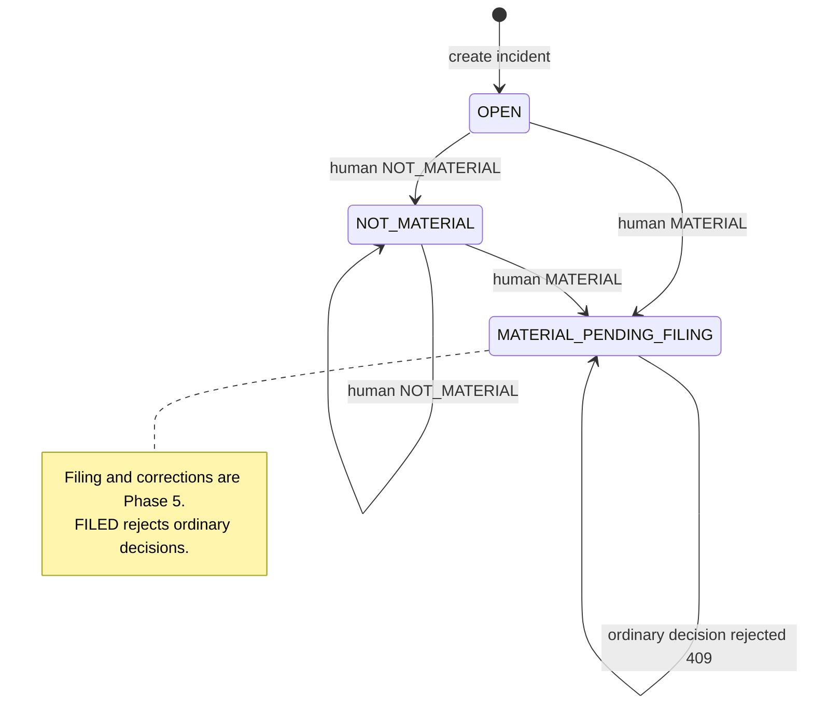
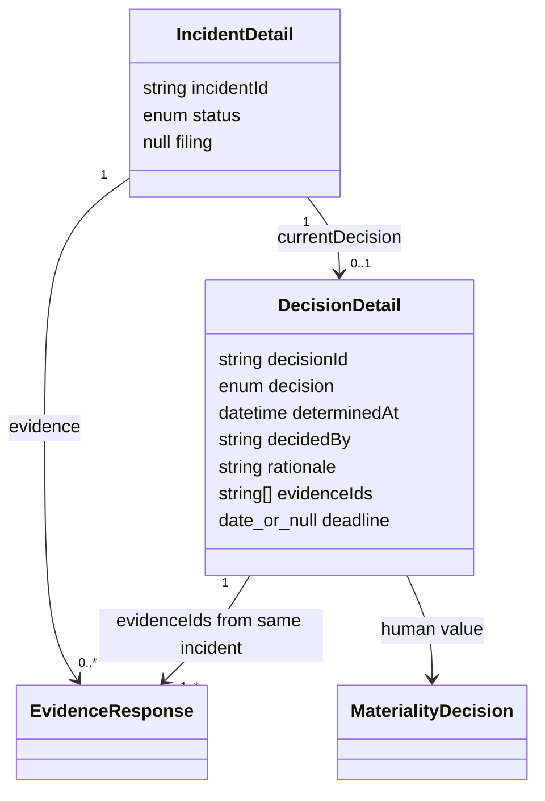

# Phase 4 decision models

Astha's implemented service and API model; persistence/calendar remain injected
dependencies. See [integration handoff](../phase4/astha-decisions.md).





The diagram describes public snapshots, not new ORM tables. Decision history is
append-only behind the repository. Current means latest recorded, not greatest
determinedAt. Status derives from the current human decision (plus future filing
state); deadline derives on demand from that decision and the shared calendar.
No evidence content, category, or severity can choose materiality.

```mermaid
sequenceDiagram
    participant Client
    participant Auth as Existing middleware
    participant Route as Decision route
    participant Service as DecisionService
    participant Repo as Injected repository
    participant Calendar as Injected calendar
    Client->>Auth: POST decisions + X-API-Key
    Auth->>Route: authenticated request
    Route->>Service: get incident before parsing
    Service->>Repo: get snapshot
    Route->>Route: parse and validate DecisionCreate
    Route->>Service: record decision
    Service->>Repo: begin locked transaction; fresh snapshot
    Service->>Service: validate time, evidence, workflow state
    opt MATERIAL
        Service->>Calendar: calculate deadline
    end
    Service->>Repo: append human decision and links
    Repo-->>Service: generated decisionId
    Service->>Repo: context exit commits; exception rolls back
    Service-->>Route: DecisionCreated
    Route-->>Client: 201 decisionId, status, deadline
```

GET incident loads the current decision through the same service. GET
deadline-status validates optional as_of after parent lookup and delegates
status/counting to the shared calendar. Missing real adapters produce explicit
503 on new routes; diagrams do not imply completed production integration.
