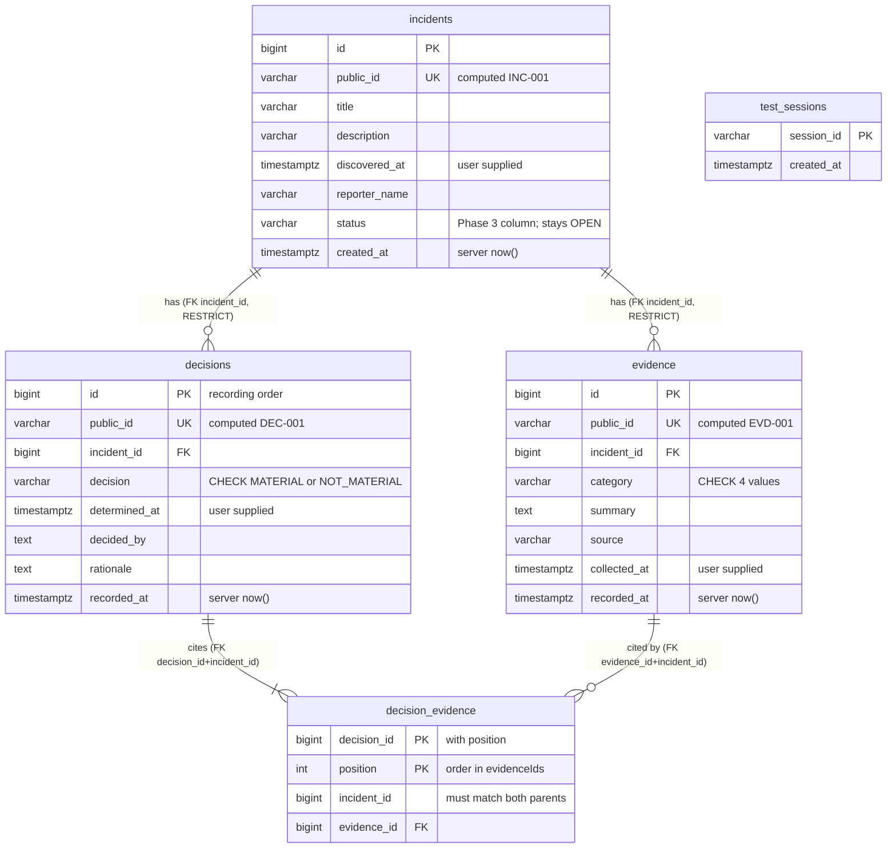
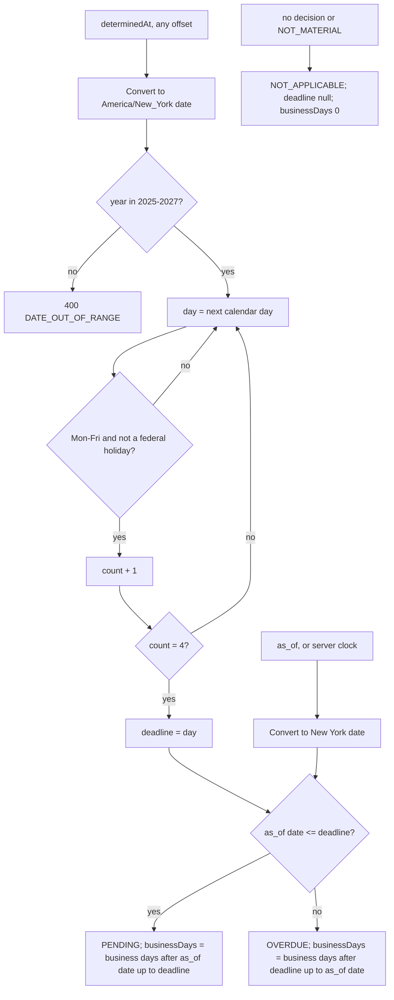

# Phase 4 storage, deadline and deployment models

Owner: Srihari; reviewer Astha (storage), Mohit (deadline model). Describes the
code on `phase4/srihari-calendar-storage`. Every table, column and component
below exists in `app/models.py`, `migrations/versions/0003_decisions.py`,
`app/deadline_calendar.py`, `app/holidays.py` or the Cloud Run deployment.
Public API shapes and the incident state machine are in
[phase4-decisions.md](phase4-decisions.md) (Astha).

## 1. Database (PostgreSQL 16, Alembic head `0003`)



| Rule | How the database or code enforces it |
| --- | --- |
| Decisions and links are append-only (REQ-07) | No UPDATE/DELETE path in the API; foreign keys are `ON DELETE RESTRICT`; only `/reset` (TRUNCATE) removes rows |
| Cited evidence belongs to the same incident (REQ-05) | Service check, plus composite foreign keys `(evidence_id, incident_id)` → `evidence(id, incident_id)` and `(decision_id, incident_id)` → `decisions(id, incident_id)`. A cross-incident link fails with IntegrityError even if the service is bypassed |
| `evidenceIds` returned exactly as sent | `position` column keeps order; a repeated ID is two rows |
| Current decision | Newest `decisions.id` for the incident (recording order, not `determined_at`) |
| Status and deadline are never stored | Derived on read by `DecisionService` + calendar. `incidents.status` is the Phase 3 column and is not updated, so it can never disagree with the decision rows |
| A rejected decision writes nothing (REQ-05) | One transaction per decision; any error rolls back the decision and its links |
| One decision at a time per incident (REQ-08) | `SELECT … FOR UPDATE` on the incident row; the second request waits, re-reads, and gets 409 |
| Reset (REQ-14) | `TRUNCATE decision_evidence, decisions, evidence, incidents RESTART IDENTITY` in one transaction, used by `/reset` and `/test/setup`; IDs restart at INC/EVD/DEC-001 |

Migration `0003` adds a unique constraint `evidence(id, incident_id)`, then
the two new tables; it changes no Phase 3 row (tested by downgrading to `0002`,
inserting a Phase 3 incident, and upgrading).

## 2. Decision write transaction

```mermaid
sequenceDiagram
    participant S as DecisionService (Astha)
    participant R as SQLAlchemyDecisionRepository
    participant C as DeadlineCalendar
    participant DB as PostgreSQL
    S->>R: transaction(incidentId)
    R->>DB: ROLLBACK (end any read) then SELECT incident FOR UPDATE
    alt incident missing
        R-->>S: 404 NOT_FOUND
    end
    R->>DB: SELECT evidence, newest decision + links
    R-->>S: locked snapshot
    S->>S: validate time, evidence ownership, state (400 / 409)
    opt decision = MATERIAL
        S->>C: calculate_deadline(determinedAt)
        C-->>S: date, or 400 DATE_OUT_OF_RANGE
    end
    S->>R: append_decision(data)
    R->>DB: INSERT decisions; flush (gets DEC id)
    R->>DB: INSERT decision_evidence rows; flush
    S-->>R: leave context
    R->>DB: COMMIT (any exception above: ROLLBACK)
```

## 3. Deadline model (REQ-09, REQ-10)



| Input | Value used |
| --- | --- |
| Day 0 | The Eastern calendar date of `determinedAt` (not counted) |
| Business day | Monday-Friday not in `app/holidays.py` |
| Holiday list | `us-federal-2025-2027.v1`: 34 US federal holidays as observed (5 U.S.C. 6103), 2025-2027; Saturday holidays move to Friday, Sunday to Monday (2027-12-31 is New Year 2028 observed) |
| Time zone | `America/New_York` (EST/EDT), never a fixed offset |
| Boundary | PENDING through 23:59:59 Eastern on the due date; OVERDUE from 00:00 Eastern the next day |
| Invalid configuration | Duplicate, weekend or out-of-range holiday entries stop the app at import (`CalendarConfigError`) |

Reference results, all asserted in `tests/unit/test_deadline_calendar.py`:
2026-09-22→2026-09-28 (Q5.1), 2026-09-28→2026-10-02 (Model 3),
2025-09-29→2025-10-03 (AC-09), 2025-10-10→2025-10-17, 2025-11-25→2025-12-02,
2025-12-30→2026-01-06, 2025-10-04→2025-10-09 (AC-10). Model 3 status counts:
Oct 1 PENDING 1, Oct 5 OVERDUE 1, Oct 6 OVERDUE 2.

## 4. Deployment

```mermaid
flowchart LR
    G[Grader / podmate test runner] -- HTTPS + X-API-Key --> API
    G -- HTTPS --> T
    subgraph GCP project ece30861-project-62ca4b, region us-central1
        T[Cloud Run: incident-tester\n1 vCPU, 1 GiB, min=max=1\nimage tester:SHA]
        API[Cloud Run: incident-api\n1 vCPU, 512 MiB, min=max=1\nimage api:SHA, X-App-Commit header]
        SQL[(Cloud SQL incident-db\nPostgreSQL 16, db-f1-micro\n10 GB SSD, database incident_db)]
        SM[Secret Manager\napi-key, database-url,\ntester-target-keys if present]
        AR[Artifact Registry\nincident-api/api:SHA, tester:SHA]
        CB[Cloud Build]
        LOG[Cloud Logging\napp.requests lines]
    end
    T -- HTTPS + key --> API
    API -- Unix socket /cloudsql --> SQL
    SM -. env at start .-> API
    SM -. env at start .-> T
    CB -- builds git archive of ref --> AR
    AR --> API
    AR --> T
    API -- stdout --> LOG
    T -- stdout --> LOG
```

| Item | Value |
| --- | --- |
| Release | `scripts/deploy_gcp.sh <git ref>` / `scripts/deploy_tester_gcp.sh <ref>`: Cloud Build builds a clean `git archive` of the ref, tags the image with the short commit, deploys a new Cloud Run revision |
| Version mapping | Image tag = commit; the API returns it in every `X-App-Commit` response header |
| Schema | Container start runs `alembic upgrade head` before serving (`scripts/start.sh`), so `0003` applies on the first Phase 4 revision |
| Always on | One warm instance each (min=max=1): no cold start; single instance because tester sessions live in memory |
| Persistence | All data in Cloud SQL; app restarts and new revisions never touch it; only `/reset` and `/test/setup` clear it |
| Secrets | Secret Manager, injected as environment variables at start; nothing secret in the repo or images |
| Logs | One `app.requests` line per request: request ID, method, path, status, duration, incident IDs; never keys or bodies |
| Cost | About $20-25/month (Cloud SQL + two warm instances), free-trial credit, $50 budget alert |
