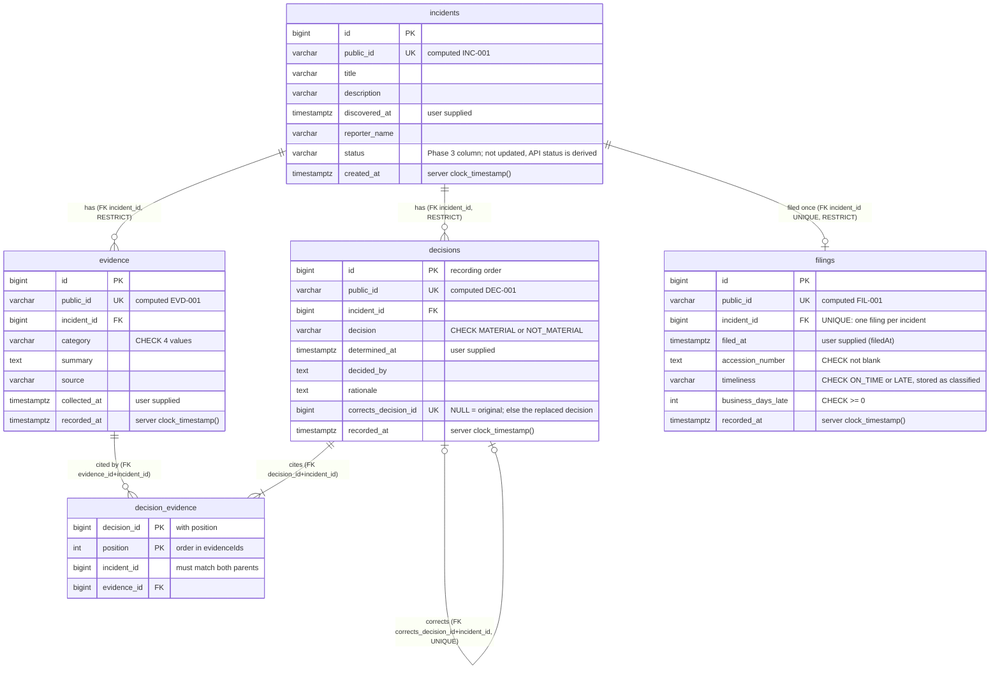
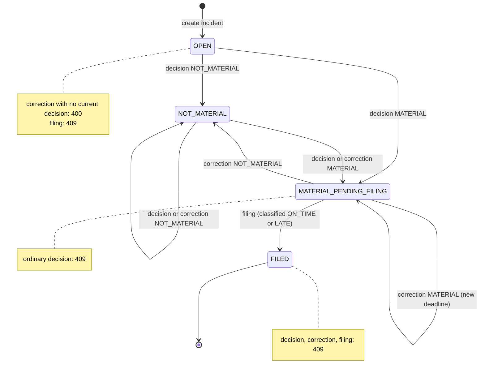
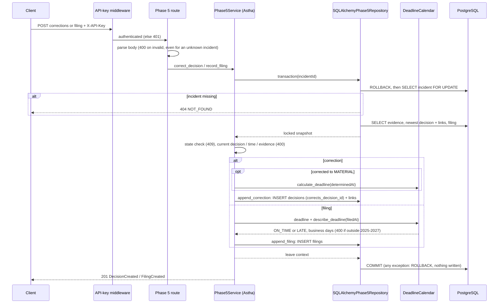

# Phase 5 storage, workflow and deployment models

Owner: Srihari; reviewers Astha (state machine, routes), Mohit (test mapping).
Describes the system **as delivered** at `integration` `edb3573`, deployed as
Cloud Run revision `incident-api-00010-srt` (2026-11-23T01:09:57Z). Every
table, column, transition and component below exists in `app/models.py`,
`migrations/versions/0004_filings_and_corrections.py`,
`app/services/phase5_store.py`, `app/services/phase5.py`,
`app/services/decisions.py`, `app/routes/phase5.py` or the Cloud Run setup.
Updates the Phase 4 models in [phase4-storage-deployment.md](phase4-storage-deployment.md)
and [phase4-decisions.md](phase4-decisions.md); what changed is listed under each model.

## 1. Database (PostgreSQL 16, Alembic head `0004`)

Changed from Phase 4: new `filings` table; `decisions.corrects_decision_id`;
recording times default to `clock_timestamp()` instead of `now()`; reset also
truncates `filings`.



| Rule | How the database or code enforces it |
| --- | --- |
| Corrections never overwrite (REQ-07) | A correction is a new `decisions` row; nothing is updated or deleted. FKs are `ON DELETE RESTRICT`; only `/reset` and `/test/setup` (TRUNCATE) remove rows |
| History is one chain | `corrects_decision_id` is UNIQUE (a decision is superseded at most once) and a composite FK with `incident_id` (same incident only); CHECK it is not the row itself |
| Current decision | Newest `decisions.id` for the incident (recording order), so the latest correction is current |
| One filing per incident | `filings.incident_id` UNIQUE: a second filing fails in the database even if two requests race |
| Filing makes the incident FILED | Status is derived on read: a filing row means FILED; no status column is written |
| Recorded filing never changes | `timeliness` and `business_days_late` are stored as classified at filing time |
| Recording order is trustworthy | `clock_timestamp()` is the insert time; `now()` (Phase 4) was transaction start, which a write waiting on the incident lock could get earlier than the write it waited behind |
| Reset (REQ-14) | `TRUNCATE filings, decision_evidence, decisions, evidence, incidents RESTART IDENTITY`: all project data, IDs restart at 001 |

## 2. Incident state machine (as implemented)

Changed from Phase 4: adds corrections and the FILED state; FILED is terminal.
Status is never stored; `decision_status()` derives it from the current decision
and the filing.



A correction must name the current decision in `correctsDecisionId`; any other
value is 400 `INVALID_CORRECTS_DECISION_ID` (pod has not fixed 400 vs 409).

## 3. Correction and filing write transaction

Changed from Phase 4: same lock-validate-append-commit pattern, now in
`SQLAlchemyPhase5Repository`, with two new append operations. The route
parses the body **before** looking up the incident (see section 5).



## 4. Timeline read

New in Phase 5.

```mermaid
sequenceDiagram
    participant Client
    participant R as SQLAlchemyPhase5Repository
    participant DB as PostgreSQL
    Client->>R: GET /incidents/{id}/timeline (after auth)
    R->>DB: SELECT incident FOR SHARE (waits for a write in progress, blocks new writes)
    alt incident missing
        R-->>Client: 404 NOT_FOUND
    end
    R->>DB: SELECT evidence, decisions, filing of the incident
    R->>R: events sorted by recorded_at, then kind, then row id
    R->>R: evidenceCounts by category; days from discoveredAt to current determinedAt
    R->>DB: ROLLBACK (release the shared lock; nothing written)
    R-->>Client: 200 incidentId, events, evidenceCounts, discoveryToDeterminationDays
```

| Field | Rule as implemented |
| --- | --- |
| `eventType` | INCIDENT_CREATED, EVIDENCE_ADDED, DECISION_RECORDED (original or ordinary decision), DECISION_CORRECTED (row with `corrects_decision_id`), FILING_RECORDED |
| Order | Server recording time only; user-entered `determinedAt`/`collectedAt`/`filedAt` never reorder events |
| `discoveryToDeterminationDays` | Exact elapsed days to the current decision, 2 decimals; `null` with no decision. **Provisional**: the other pod expects whole days (open specification issue) |

## 5. Request validation order (Phase 2 Model 4) vs implementation

| Route | Order implemented | Matches Model 4 (auth, route, incident, body, state)? |
| --- | --- | --- |
| `POST /incidents/{id}/evidence`, `POST /incidents/{id}/decisions` | auth, incident, body, state | Yes |
| `POST /incidents/{id}/corrections`, `POST /incidents/{id}/filing` | auth, **body, incident**, state | **No**: malformed body on an unknown incident gives 400 instead of 404 (found by the other pod's tester, 2026-11-22; system defect, owner Astha, not yet fixed) |
| `GET /incidents/{id}/timeline` | auth, incident | Yes (no body) |

## 6. Deployment (unchanged architecture; Phase 5 values)

The Phase 4 deployment diagram (section 4 of
[phase4-storage-deployment.md](phase4-storage-deployment.md)) still holds:
two Cloud Run services (min = max = 1), Cloud SQL PostgreSQL 16, Secret
Manager, Artifact Registry, Cloud Build, Cloud Logging. Phase 5 values:

| Item | Value (observed 2026-11-23) |
| --- | --- |
| API | `incident-api`, revision `incident-api-00010-srt`, image `api:edb3573`, `X-App-Commit: edb3573` |
| Tester | `incident-tester`, revision `incident-tester-00007-cth`, image `tester:edb3573` |
| Schema | `alembic upgrade head` at container start; log `Running upgrade 0003 -> 0004` at 2026-11-23T01:10:08Z |
| Database | Cloud SQL `incident-db`, POSTGRES_16, db-f1-micro; automatic backups **off** |
